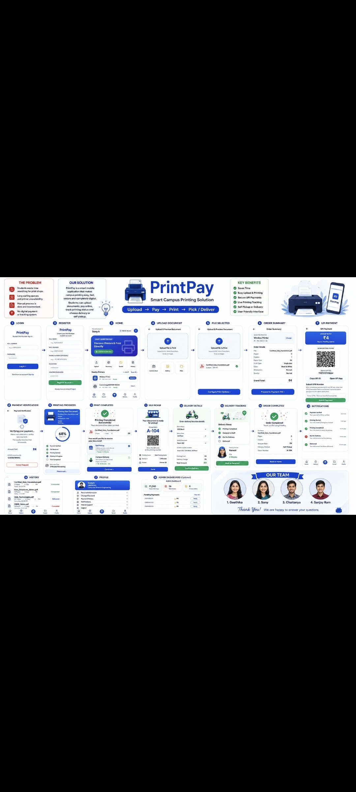

# 🖨️ PrintPay - Smart Campus Printing Solution

## 📌 Project Overview
**PrintPay** is a smart mobile application designed to eliminate long waiting queues and printing unavailability in campus print shops. Students can easily upload documents, pay online, track printing status, and choose self-pickup or delivery.

---

## 📱 App Workflow & UI Screens
*(Below is the complete workflow and UI design of the application)*

---

## 🚀 Key Features & Workflow
* **Document Upload & Preview:** Securely upload and preview PDF, Word, and PowerPoint files.
* **Smart Printer Discovery:** Discover nearby wireless or network printers on campus easily.
* **Secure UPI Payments:** Instant payment verification using integrated UPI QR codes.
* **Live Order Tracking:** Real-time tracking from document printing to self-pickup or campus delivery.
* **Admin Dashboard:** Complete management dashboard for print shop owners to monitor earnings and queue status.

---

## 👥 Our Team
* Geethika(CSE - AI & ML)
* Sony K (CSE - AI & ML)
* Chaitanya(CSE - AI & ML)
* Sanjay Ram(CSE - AI & ML)
